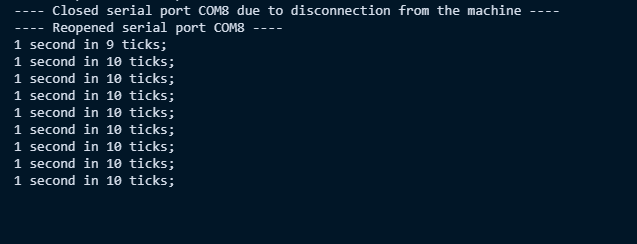
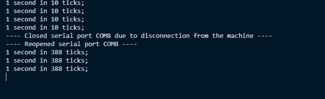

# RP2040 Cold-Start Timer Bug

This project reproduces a timer-frequency problem observed on a Raspberry Pi
Pico after a full power cycle. The kernel's timekeeping expects the RP2040
hardware timer to advance in microseconds. With the timer tick setup line
disabled, the counter task can appear to work after some starts, but after a
cold start its one-second reports may arrive only about every 38.8 seconds.

Enabling the tick setup line in [`kernel/sysdepend/pico_rp2040/cpu_clock.c`](kernel/sysdepend/pico_rp2040/cpu_clock.c) line 121 
makes the timer behave consistently after cold starts.

## Reproduce the issue

1. In `cpu_clock.c`, make sure the fix line is **commented out**:

   ```c
   // out_w(0x4005802C, (XOSC_MHz | (1 << 9)));
   ```

2. From the project root, build the single-core USB-CDC profile:

   ```sh
   mingw32-make -C build_make E2U=tools/elf2uf2.exe CONSOLE=usb_cdc -j8
   ```

   The build produces `build_make/mtk3pico_smp0_usb_cdc.uf2`.

3. Flash that UF2 to the Pico. Hold **BOOTSEL** while connecting the Pico to
   enter its bootloader, then copy the UF2 to the `RPI-RP2` drive.
4. Start the board and observe the counter output. It should initially print
   about once per second.
5. Flip the pico's power switch off and on again. This creates the cold start 
conditions and the counter output should now arrive roughly every **38.8 seconds**, 
even though it should be appearing once every second.


^ Correct output where each counter output appears once every second (~10 ticks)


^ Incorrect output where the slower clock causes each output to appear every ~38.8 seconds.

The counter task in
[`app_program/counter_task.c`](app_program/counter_task.c) reads the RP2040
hardware timer and prints when it believes one million microseconds have
elapsed. It also delays for 100 ms between checks. The printed count is the
number of task iterations observed during that interval; it is not itself the
timer frequency measurement.

## Verify the fix

Uncomment the line in `cpu_clock.c`:

```c
out_w(0x4005802C, (XOSC_MHz | (1 << 9)));
```

Rebuild with the same command:

```sh
mingw32-make -C build_make E2U=tools/elf2uf2.exe CONSOLE=usb_cdc -j8
```

Flash `build_make/mtk3pico_smp0_usb_cdc.uf2` and repeat the full power cycle.
The counter should continue reporting at about one-second intervals instead
of slowing down after a cold start.

## What the fix does

The address `0x4005802C` is the RP2040 watchdog tick register. The expression
sets its tick-cycle field to `XOSC_MHz` (12 for the Pico's 12 MHz crystal) and
sets bit 9 to enable the tick generator. In effect, the generator produces a
tick every 12 crystal cycles, which corresponds to one microsecond at 12 MHz.
The RP2040 hardware timer uses this tick as its time base, so configuring it
matches the timer's rate to the microseconds assumed by the kernel and by
`time_us()`.

The confirmed behavior is that explicitly configuring this tick fixes the
cold-start timing problem. The exact reason the unconfigured build initially
appears to work and then behaves differently after a full power cycle has not
been established here. A warm start or bootloader path may leave clock or tick
state different from a power-on reset, but attributing the issue specifically
to BOOTSEL or to a slower system clock would be speculation. The fix configures
the timer tick directly rather than relying on startup state.

## Viewing the counter output

This project is built with USB CDC, so connect the Pico through its USB
connector and open its serial (COM) port on Windows with a serial terminal.
The USB-CDC profile requires TinyUSB from the Pico SDK; if the build reports
that TinyUSB cannot be found, set `PICO_SDK_PATH` to the SDK checkout when
invoking `mingw32-make`.